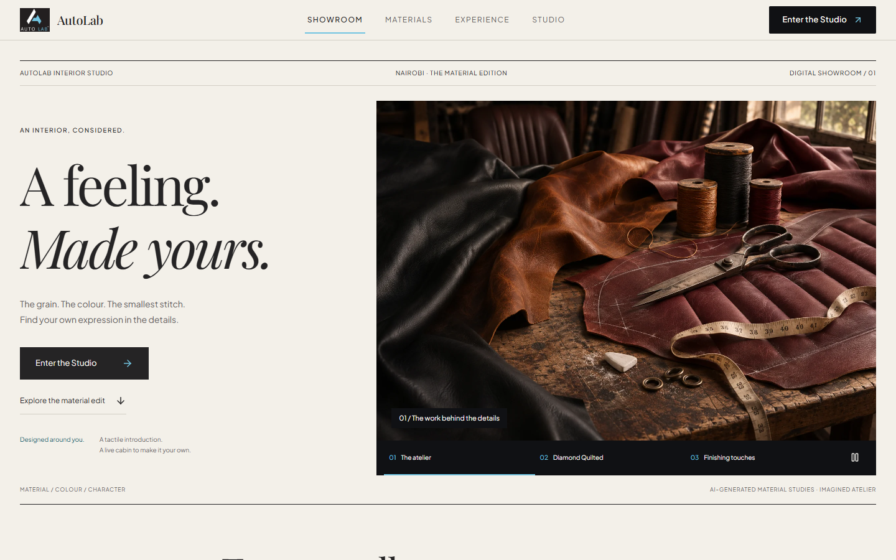
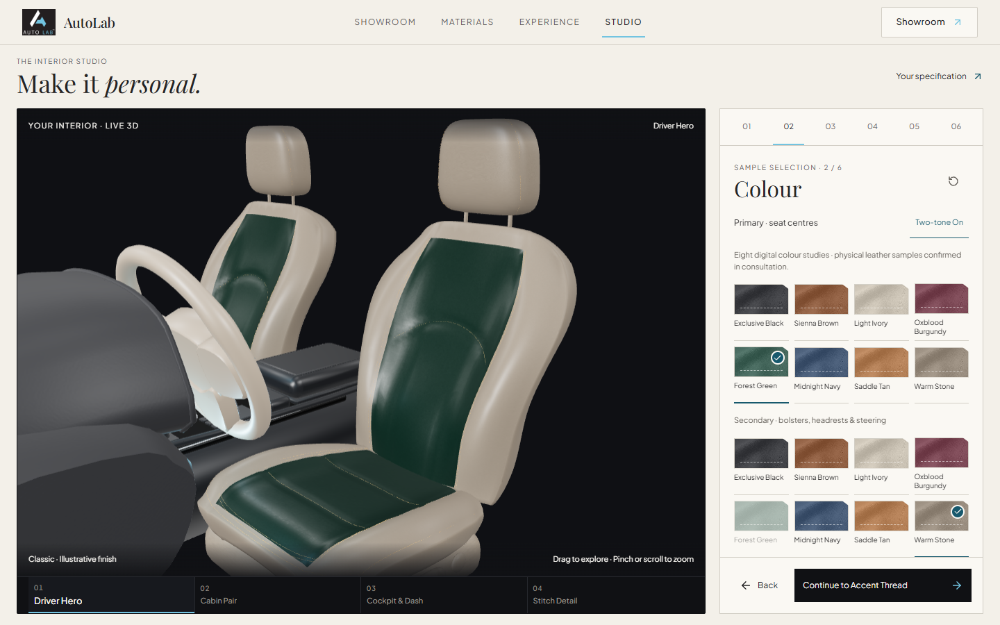

# AutoLab Digital Showroom

An interactive automotive interior demonstrator: an editorial, ivory-and-graphite showroom built around a real 3D front cabin. This is the **independent experimental UI**, not the authoritative AutoLab production application.



## What is implemented

### Showroom and Studio experience

- Authentic AutoLab branding, editorial typography and responsive desktop/mobile layouts.
- Original AI-generated material studies and a warm, work-in-progress upholstery atelier hero.
- Photographic closing invitation, restrained text/image motion, pause controls and reduced-motion support.
- A live cabin that stays visible while the configuration panel slides between selections.
- Tactile material, leather-colour, thread, composition, trim and ambient-light selectors.
- Back preserves choices and the current camera view. Reset is clearly labelled and requires confirmation.
- A specification summary reflecting the current configuration, with links back to edit selections.

### Actual 3D interaction

| Control | Live behaviour |
| --- | --- |
| Upholstery | Classic, Diamond Quilted and Perforated load three actual KTX2/Draco GLBs. |
| Leather colour | Eight options: Exclusive Black, Sienna Brown, Light Ivory, Oxblood Burgundy, Forest Green, Midnight Navy, Saddle Tan and Warm Stone. |
| Composition | Single-colour applies primary to both seat zones. Two-tone separates seat centres from bolsters/headrests; steering leather follows the secondary zone. |
| Accent thread | Recolours stitching, including the Diamond quilting thread shader. |
| Cameras | Driver Hero, Cabin Pair, Cockpit & Dash and Stitch Detail use the original source presets and orbit limits. |
| Trim | Illustrative wood, lacquer and carbon previews affect dashboard and console inserts together; console black/metal parts retain their finishes. |
| Ambient light | Five illustrative coloured-light previews; these are not modelled LED installations. |

The viewer uses one WebGL canvas, seven material bindings, KTX2/Draco decoding, loading/error states and Retry recovery. No backend, pricing, orders or commercial approvals are implied.



## Run locally

Requires **Node.js >=22.12** and npm.

```sh
npm ci
npm run dev
```

Development: http://127.0.0.1:5173/ . Open `/studio` for the cabin.

```sh
npm run build
npm run preview
```

Build preview: **http://127.0.0.1:4173/** . Port 3000 belongs to the separate production project and will not show this experiment.

Configuration is held in React memory: in-app navigation retains choices, but a full reload starts a fresh configuration. No account or API key is required.

## Validation

```sh
npm test
npm run typecheck
npm run lint
npm run build
```

Latest repair: **39 unit tests passed**, typecheck/lint/build passed, and two desktop/mobile browser regression journeys passed. They inspect actual material state, preserved camera/viewer state, reset cancellation and intentional reset. Earlier recorded checks cover all three GLBs, bindings, decoding, camera presets, responsive layouts and loader recovery; see the reports below for their exact scope and dates.

Browser tests use installed Microsoft Edge and Playwright with software WebGL. Keep a normal preview running on 4173. In a separate PowerShell terminal, prepare and serve the diagnostic build:

```powershell
$env:VITE_E2E='1'
npm run build -- --outDir dist-e2e
Remove-Item Env:VITE_E2E
npx vite preview --host 127.0.0.1 --outDir dist-e2e --port 4174 --strictPort
```

In another terminal:

```sh
npm run test:e2e -- --project=runtime
npm run test:e2e -- --project=release
```

The runtime project targets 4174; the release project targets the normal build on 4173 and checks that diagnostics are absent. Do not use the diagnostic build for the owner preview. Tests write screenshots, recordings and reports under `docs/evidence/`.

## Implementation and evidence

| Work | Report |
| --- | --- |
| Integration architecture and execution | [Implementation record](docs/IMPLEMENTATION.md) |
| Viewer, assets, validation and known defects | [Original integration handoff](docs/FINAL_HANDOFF.md) |
| Cinematic, cabin-first configuration flow | [Cinematic Studio](docs/CINEMATIC_STUDIO.md) |
| Generated imagery and tactile selectors | [Editorial refinement](docs/EDITORIAL_REFINEMENT.md) |
| Atelier atmosphere and eight-colour palette | [Atelier refinement](docs/ATELIER_REFINEMENT.md) |
| Back and reset repair | [Navigation fix](docs/BACK_NAVIGATION_FIX.md) |
| Current continuation notes | [State](docs/STATE.md) |

[Watch the recorded selector interactions](docs/evidence/editorial/selectors-1440.webm). This recording predates the expanded palette; the screenshots above show the newer colours.

## Provenance and limitations

- Reused first-party viewer/assets come from production source commit `12558846c5f3635539a45174530a6599dbdbff28`, exported from committed Git objects. The production working tree remained read-only. See [provenance](docs/PROVENANCE.md) and [source manifest](docs/SOURCE_MANIFEST.json).
- Current editorial imagery is generated illustration, not photography of AutoLab commissions or the actual workshop. Prompts, asset hashes and screenshots are retained. Legacy inherited image provenance still needs clearance before public use.
- All colours/treatments are digital samples. Physical finish, stock, service availability and calibrated colour matching require consultation.
- Existing seat shading, geometry/UV and simplified cockpit limitations remain. This UI work does not certify visual fidelity.
- Browser results use Edge/SwiftShader; physical-phone, Safari and hardware GPU performance remain unverified. The existing large renderer-chunk warning remains; seven previously recorded moderate development-dependency audit findings remain unresolved.
- Dependencies and decoder notices are retained in `public/licenses/`. Their licences do not grant ownership of AutoLab's branding or assets.

**Ready for a controlled owner demonstration, with the limitations above. No production deployment or merge has been performed.**
