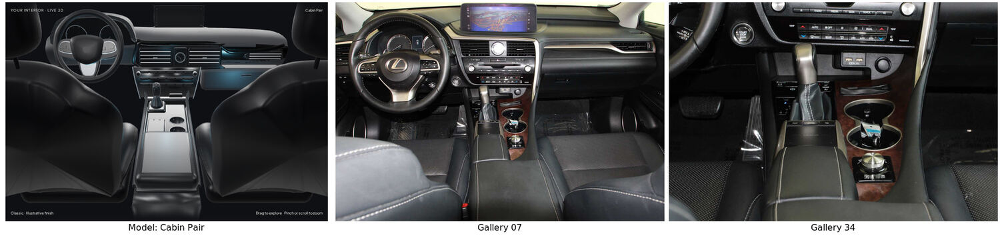
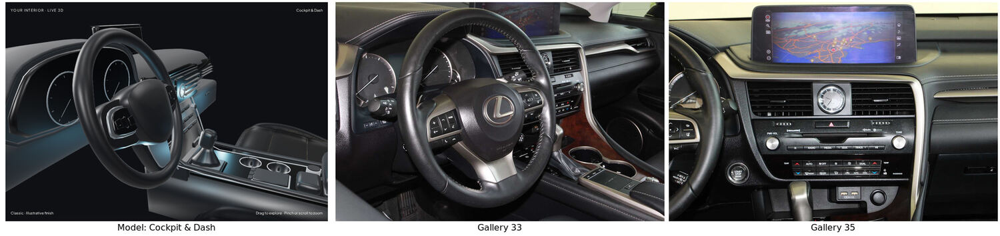
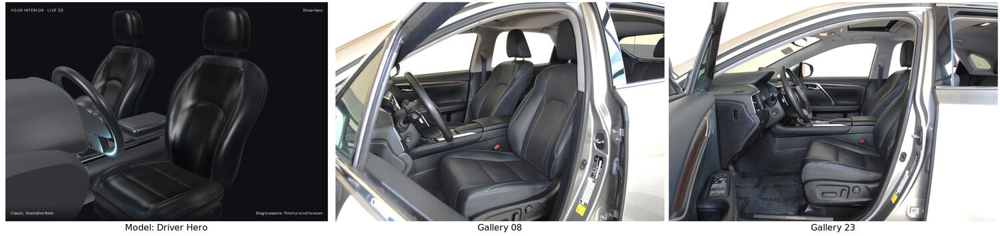
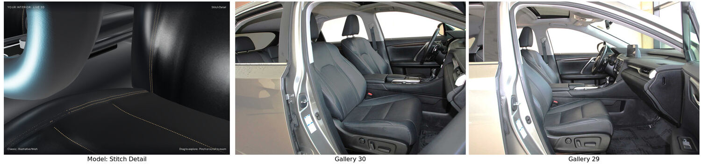

# Model-to-photo reconciliation

Status: assessment only. No GLB, viewer, camera, material, shader or texture file was changed.

## What was compared

**Model:** the three production GLBs, unchanged (SHA-256 prefixes `e5bdde01…` Classic, `4c217dd0…` Diamond, `d53f5554…` Perforated). They share one geometry: 11 nodes, 24 primitives, 66,260 triangles, 24 draw calls, 10 materials (`MAT_Seat_Primary`, `MAT_Seat_Secondary`, `MAT_Seat_Stitching`, `MAT_Steering_Leather`, `MAT_Dashboard_Trim`, `MAT_Cockpit_Accent`, `MAT_Console_Carbon`, `MAT_Console_Black`, `MAT_Console_Metal`, `MAT_Cockpit_Black`). Nodes: `GEO_Seat_Front_Driver`, `GEO_Seat_Front_Passenger`, `GEO_Seat_Stitching_Front`, `GEO_Seat_Stitching_Front_Passenger`, `GEO_SteeringWheel_Lexus`, `GEO_Dashboard_Lexus`, `GEO_Console_Body`, `GEO_Console_Armrest`, `GEO_Console_Cupholder_Front`, `GEO_Console_Cupholder_Rear`, `GEO_Console_Selector`.

**Renders:** the four existing camera presets in `src/config/lexus-camera-presets.ts`, captured from a local production build (`vite preview`, SwiftShader, 1440×900, default Classic/black configuration, no page errors). Software rendering — colours and lighting are indicative only.

**Photos:** the gallery images named per row (see `GALLERY_VISUAL_INDEX.md`).

## Side-by-side evidence

| Model view | Paired with | Sheet |
|---|---|---|
| Cabin Pair | Gallery 07, 34 |  |
| Cockpit & Dash | Gallery 33, 35 |  |
| Driver Hero | Gallery 08, 23 |  |
| Stitch Detail | Gallery 30, 29 |  |

Camera positions differ between the model presets and the photos; pairs show the same components, not matched viewpoints. Photo-matched cameras would need the camera presets changed, which is out of scope.

## Component reconciliation

Discrepancy classes: **Acceptable** (matches the photos at showroom distance), **Incomplete** (present but missing visible sub-parts), **Incorrect** (present but contradicts the photos), **Missing** (not in the model).

| # | Component | Gallery evidence | Existing model | Discrepancy | Evidence confidence | Recommended treatment | Remaining uncertainty |
|---|---|---|---|---|---|---|---|
| 1 | Front seats | 07, 08, 17, 23, 27, 29, 30, 34 | `GEO_Seat_Front_*`; sport-style bucket with tall wing bolsters, smooth panels, horizontal cushion seams; stitching as separate mesh with thread mask | **Incorrect** silhouette and zoning. Photos show flatter comfort bolsters, distinct perforated centre inserts on cushion and backrest with vertical channels, light-grey contrast stitch, outboard side shield with power switches | High (8 photos, one car, multiple angles) | Geometry: re-shape bolsters and insert boundaries. Material: map inserts to `MAT_Seat_Primary`, bolsters to `MAT_Seat_Secondary`. Shader: keep thread-mask alpha contract; perforation stays texture-based | Seam depth, foam crown height, exact perforation pitch, rail and underside; leather vs NuLuxe |
| 2 | Rear seats | 05, 15, 25, 26, 31, 32 | None | **Missing** | High for layout (40/20/40 split, 3 headrests, stitched panels) | Geometry (later phase, budget-limited) | Armrest, folding geometry, dimensions |
| 3 | Dashboard and instrument panel | 06, 07, 16, 18, 20, 23, 29, 33, 35 | `GEO_Dashboard_Lexus`: cluster hood with two dials, central round element between vents, flat upper dash, cyan accent strip, small display stub; large flat grey end cap | **Incomplete**: no floating wide display hood, no audio/climate stack detail, no satin-silver sweep across passenger dash, no two-tier passenger dash. **Incorrect**: dash end cap renders as a large untextured grey block (real cap is black and hidden by the shut door, 23, 29). Clock position and twin-dial cluster are acceptable | High | Geometry: display hood, stack face, passenger tier. Material: end cap to black; satin strip as `MAT_Cockpit_Accent`. Texture: cluster faces (emissive) | Dash depth and curvature; HUD presence |
| 4 | Centre console and gear selector | 07, 19, 33, 34 | `GEO_Console_Body`, armrest, two inline cupholders, `GEO_Console_Selector` (bare stick); console top reads as light grey/flat | **Incorrect** top finish and **Incomplete** parts: photos show gloss reddish-brown wood around the cupholders, satin outline, leather-booted shifter with satin cap, Remote Touchpad block, drive-mode knob, HOLD/EPB/seat-climate switch pod, stitched black armrest. Cupholder count and inline order are acceptable | High | Geometry: touchpad block, drive-mode knob, shifter boot. Material: wood on console panel (currently `MAT_Console_Carbon` slot — trim preview mapping must be kept). Texture: switch legends | Wood species; exact sizes |
| 5 | Steering wheel and controls | 07, 21, 22, 33 | `GEO_SteeringWheel_Lexus`: black three-spoke wheel, silver hub ring, small switch blocks | **Incomplete**: no satin-silver lower spoke and side bezels, simplified switch pads, no L emblem shape, no visible rim stitching | High | Geometry: spoke bezels, switch pads. Material: satin bezel on accent material. Texture: switch legends, rim stitch | Rim cross-section; airbag seams |
| 6 | Front door panels | 08, 17, 23, 24, 29, 33 | None | **Missing**. Its absence also exposes the dash end cap in Driver Hero | High (24 is a full front card) | Geometry (simple card; later phase) | Card depth; speaker size |
| 7 | Rear door panels | 25, 26, 31, 32 | None | **Missing** | Medium–high (same design as fronts) | Geometry, after front doors | Exact rear-card shape |
| 8 | Roof, headliner and pillars | 05, 15, 17, 23, 25, 29 | None | **Missing** | Medium (17 is the main view) | Geometry (later phase) | Moonroof aperture, seams, grab handles |
| 9 | Floor, carpet and footwells | 07, 23, 29, 31, 34 | None (seats float on the studio backdrop) | **Missing** | Medium (dealer protective mats cover much of it) | Geometry: simple carpeted floor plane/tray. Counts against the 24 draw-call budget | Pedals, rails, sill |
| 10 | Centre tunnel and lower cabin | 07, 23, 29, 31 | Console body sides only | **Incomplete** | Medium | Geometry with the floor | Tunnel section |
| 11 | Rear ventilation and controls | 31 | None | **Missing** | Medium (one photo shows twin vents on the console rear) | Geometry, only if rear cabin is in scope | Controls below vents |
| 12 | Other visible details (glovebox, overhead console, start button, USB, sill) | 17, 19, 20, 23, 27, 34, 35 | None, except start-button-like detail not present | **Missing**; low customer importance | Medium | Texture or small geometry later; most stay out of scope | — |

## Technical contracts that any fix must keep

- **Material names and bindings:** the viewer finds `MeshStandardMaterial`s by name and requires the seat materials. New geometry must reuse the 10 existing names or extend the manifest and tests together.
- **Thread mask:** `src/lib/three/thread-mask.ts` reads the roughness-map alpha channel. Re-zoned seats must keep stitch UVs on that mask.
- **KTX2 / Draco:** textures are BasisU (KTX2) and meshes Draco-compressed through `scripts/finalize-front-cabin.mjs` in the original repository; the decoders are self-hosted.
- **Cameras:** the four presets and orbit limits stay unchanged until the owner approves a camera change.
- **Budgets:** 80,000 triangles, 24 draw calls, 5 MB per model. The model is at 66,260 triangles (13,740 spare) and already at 24 draw calls, so any new part must share an existing primitive/material or replace one.
- **Integrity:** the 3D-0 gate (PR #3) pins the production hashes; any rebuilt GLB fails it on purpose until the owner accepts a new baseline.
